# CRI-O statsserver redesign — design artifacts

Design exploration for refactoring `internal/lib/statsserver` (the CRI stats / CRI metrics / VM-stats
subsystem). Motivated by issue [#10546](https://github.com/cri-o/cri-o/issues/10546) and PR
[#10550](https://github.com/cri-o/cri-o/pull/10550).

Start with the [current design](current-design.md) and the [design comparison](design-comparison.md).
The [design review](design-review.md) explains the rationale and implementation order.
The [GitHub issue draft](github-issue-draft.md) summarizes the proposed change for discussion.

Four independent architectures were generated (one per lens), cross-judged on three axes
(correctness-structural, simplicity/YAGNI, migration-risk), then synthesized.

| # | Design | Lens | Correctness | Simplicity | Migration | Avg | Verdict |
|---|--------|------|:-----------:|:----------:|:---------:|:---:|---------|
| 3 | [Two Projections, One Sample](design-3-two-projections-one-sample.md) | pragmatic | **88** | 83 | **86** | **85.7** | **WINNER** |
| 2 | [Collector-Store-Projection](design-2-collector-store-projection.md) | dataflow | 66 | **86** | 79 | 77.0 | runner-up; has a real P1 regression |
| 1 | [Layered Sample-and-Project](design-1-layered-sample-and-project.md) | layered | 82 | 66 | 71 | 73.0 | sound but heaviest |
| 4 | [Per-Sandbox Collector Registry](design-4-per-sandbox-collector-registry.md) | concurrency | 72 | 57 | 61 | 63.3 | fixes the wedge but not P3 |

---

## The six problems (what the refactor must fix)

| ID | Problem |
|----|---------|
| **P1** | Per-container collection is reimplemented **3×**; all three call `DiskStats()` but consumption differs and is invisible at the call site → a dead full-rootfs walk that `populateWritableLayer` silently overwrites |
| **P2** | `updateSandbox` computes the stats view **and** the metrics view in one loop, writing both maps — the concerns cannot be changed independently |
| **P3** | A single `sync.Mutex` guards all three maps + lifecycle deletes; it is held across the 40-180s walk |
| **P4** | The `if period==0 {update} else {cache; fallback}` dance is copy-pasted across 3-4 accessors |
| **P5** | `DiskStats` is polymorphic in cost (OCI = full-rootfs `filepath.Walk`; VM = zeros; Pod = delegate) yet called as if uniform and cheap; the OCI walk counts read-only base image layers |
| **P6** | `RemoveSandbox` holds `stateLock` while waiting on the stats mutex → `RunPodSandbox` wedges node-wide; no `ctx.Err()` check; plus `stats_collection_period` vs `collection_period` config drift |

### Current architecture (the thing being replaced)

Disk inputs and where the results are used

For OCI and the pod runtime, each `DiskStats` call walks the mounted rootfs
and reads filesystem totals with `statfs`. The OCI read also holds the
container's `opLock.RLock()` during the walk. Moving collection outside the
stats mutex breaks the wait through `stateLock` shown here. A stop of the same
container can still wait on `opLock`. [OCI disk read](../internal/oci/runtime_oci.go#L1431) · [OCI stop loop](../internal/oci/runtime_oci.go#L1031)

---

## Recommended synthesis: Design 3 + grafts

Ship **Design 3** and fold in the best ideas from the others:

1. **(from Design 2) `getOrCollect`** — confine "`collect()` runs before `Lock()`" inside a small
   store/helper with a private mutex. Publication must also reject results
   from a removed object or an older observation.
2. **(from Design 1) the `t.Fatal` CI guard test** — a fake `Runtime` whose `DiskStats()` calls
   `t.Fatal`, driven through the full stats path. Makes P1 a CI-enforced wall. *(Unanimous graft — it
   is exactly what would have caught Design 2's regression.)*
3. **(from Design 4) the explicit lock-ordering proof** — document that `Remove*` only ever does an
   I/O-free cache invalidation, so removal cannot hold `stateLock` while
   waiting for the stats cache lock to be released by a collector.
4. **(from Design 4) the blocking-fake concurrency test** — "slow collect does not block removal".
5. **Keep a single mutex**, not Design 3's `statsMu`/`metricsMu` split — unnecessary once I/O is
   off-lock (its own author concedes this). The essential change is *I/O outside the lock*, not *two locks*.
6. **Do not** touch the shared `utils.GetDiskUsageStats` for intra-walk cancellation (used by
   `server/image_fs_info.go` + 3 platform variants). Per-item `ctx.Err()` is enough; a single
   in-flight walk finishing is a documented gap.

### Migration path (TDD, each step independently shippable)

0. **PR #10550 is already step 1** — it drops `DiskStats` from the stats path, drops the
   `containerCRIStats` param, deletes `criFilesystemStats`. The refactor **extends** it, does not
   replace it.
1. Extract pure `projectContainer*/projectSandbox*` functions (behavior-preserving) + unit tests.
2. Introduce `sampleContainer` (one cgroup gather) + the `t.Fatal` guard test.
3. Thread `ctx` through the three list methods + per-item `ctx.Err()`.
4. Move gather off-lock and validate lifecycle and observation order before
   publishing. Add the blocking-fake test and replace the unsynchronized
   `alreadyShutdown` bool with `sync.Once`.

---

## Decisions for a human (deliberately kept OUT of the structural refactor)

- **P5's actual cost.** Every design only *gates* the walk; none eliminate it. The real fix is sourcing
  disk-metric usage from the graph driver (like `WritableLayer`) instead of walking `merged/`, which
  also stops the base-image-layer double-count. This is a **metric-semantics** change.
- **Config drift.** `collection_period` is read; `stats_collection_period` is inert; neither is
  validated. Making `Validate` **error** on the inert field is itself backward-incompatible (could stop
  nodes from starting) → **warn**, and treat consolidation as a separate approved change.
- **Dead API.** `MetricsForPodSandbox` (singular) has zero callers — remove it?

## Corrections to the issue's framing (found while mapping the real code)

- The lock in the wedge is **`stateLock`** (`container_server.go:61,266`), not `ctrLock` as #10546 says.
- The wedge does **not** require `collection_period > 0`: on-demand `Stats*`/`Metrics*` calls hold the
  mutex across the walk even when the background loop is idle, so default-config nodes are exposed too.

---

*Artifacts generated from a 4-design / 3-judge exploration. Diagrams are Mermaid (render on GitHub).*
