# Current CRI-O stats and metrics design

At checkout `cc36e008e`, CRI-O's `StatsServer` collects and caches the data for
the CRI container stats, pod sandbox stats, and pod sandbox metrics RPCs. On
Linux, a pod stats request can also collect metrics, and collection can hold a
shared lock long enough to block sandbox lifecycle operations.

## How requests get their data

| CRI entry point | What happens on a fresh collection |
| --- | --- |
| `ContainerStats`, `ListContainerStats`, `StreamContainerStats` | Read runtime cgroup stats and disk stats, build the container stats response, and populate its writable layer from the storage graph driver. |
| `PodSandboxStats`, `ListPodSandboxStats`, `StreamPodSandboxStats` | Read pod CPU, memory, and PID counters from the host cgroup manager and network counters through netlink in the sandbox network namespace. The same pass collects child container stats and builds pod sandbox metrics. |
| `ListPodSandboxMetrics`, `StreamPodSandboxMetrics` | Read runtime cgroup and disk stats per container and emit the enabled metric families. Network metrics use procfs at pod scope. OOM metrics make a separate host cgroup read. |
| `ListMetricDescriptors` | Return descriptors based on the configured metric families, without sampling a sandbox. |

With the default `collection_period = 0`, each data request collects on demand.
With a positive period, a background loop runs the combined sandbox refresh for
all sandboxes. Requests serve cached results when present and collect
synchronously on a miss. The three caches store response objects keyed by
sandbox or container ID. Streaming RPCs build the full list before sending
chunks. [RPC handlers](../server/) · [Cache and scheduling](../internal/lib/statsserver/stats_server.go) · [Linux collection](../internal/lib/statsserver/stats_server_linux.go) · [Network metrics](../internal/lib/statsserver/network_metrics_linux.go)

Linux collection paths and runtime sources

The expanded diagram shows the Linux runtime, storage, and network reads.
The caller continues to hold the StatsServer mutex while those reads run.

## Where platform and runtime behavior diverge

| Platform or runtime | Data source and coverage |
| --- | --- |
| Linux OCI | Container counters come from the host cgroup manager. Disk usage comes from walking the mounted rootfs, while filesystem capacity and inode totals come from `statfs`. |
| Linux VM | Container CPU, memory, PID, and hugepage data come from the shim's task `Stats` RPC. CRI-O decodes the guest's cgroup v1 or v2 payload into the shared cgroup stats struct. The VM disk method returns a zero-filled object with a successful result. Pod-level collection still uses host-side Linux sources. |
| Linux pod runtime | Container cgroup and disk methods delegate through its underlying runtime implementation. |
| Non-Linux builds | The statsserver methods return empty container and sandbox stats messages. The metrics method returns an empty wrapper, so the list handler has no pod metrics to emit. |

[OCI runtime](../internal/oci/runtime_oci.go) · [VM runtime](../internal/oci/runtime_vm_linux.go) · [Pod runtime](../internal/oci/runtime_pod.go) · [Non-Linux statsserver](../internal/lib/statsserver/stats_server_unsupported.go) · [Metrics handler](../server/sandbox_metrics_list.go)

## Why it is brittle

1. **A slow read can stall sandbox operations across the node.** The same
   mutex protects the caches and stays held during cgroup, filesystem, and shim
   reads, including across entire lists and background sweeps. Sandbox removal
   waits for that mutex while holding `stateLock`, which sandbox creation also
   needs. Both collection modes can cause this wait. Collection uses the
   server context, so a client deadline does not stop the work. The rootfs
   walk itself has no cancellation check.
   [Statsserver locking](../internal/lib/statsserver/stats_server.go) · [Sandbox lifecycle](../internal/lib/container_server.go) · [Filesystem walk](../utils/filesystem.go)
2. **Repeated collection hides which reads each RPC needs.** The combined
   sandbox pass, standalone container stats, and standalone metrics each
   invoke `DiskStats`. Both stats builders set `WritableLayer` from the disk
   result and then overwrite it with graph-driver data, even when that lookup
   fails. The disk metric family is checked after the walk. For OCI, that walk
   includes files from read-only image layers visible in the mounted rootfs.
   [Linux collection](../internal/lib/statsserver/stats_server_linux.go) · [Disk collection](../internal/lib/stats/disk_stats_linux.go)
3. **The VM adapter loses information the response builders need.** The shim
   decoder selects the guest cgroup version, but the shared result carries no
   version marker. Memory and swap conversion use the host version to choose
   keys and interpret counters, so differing host and guest versions can
   produce incorrect values. VM disk zeros can also be emitted as measurements
   when disk metrics are enabled.
   [VM decoder](../internal/oci/runtime_vm_linux.go) · [Stats conversion](../internal/lib/statsserver/stats_server_linux.go) · [Memory metrics](../internal/lib/statsserver/memory_metrics_linux.go)
4. **The periodic refresh does not maintain the standalone container cache.**
   The sandbox pass builds nested container stats and looks in the standalone
   cache for a CPU baseline, but never updates that cache. A standalone request
   that fills an entry in periodic mode can keep returning that old sample
   until removal, while nested stats continue to refresh. Nested CPU rates can
   lack a baseline or span the time since the old standalone sample.
   [Cache access](../internal/lib/statsserver/stats_server.go) · [Sandbox refresh](../internal/lib/statsserver/stats_server_linux.go)
