# Design 1 — Layered Sample-and-Project

**Lens:** layered separation of concerns  ·  **Panel verdict: third** (correctness 82, simplicity 66, migration 71)

> Collect one raw Sample per container/sandbox driven by the UNION of declared consumer needs, then
> run two pure, independent projections (CRI stats vs Prometheus metrics) over per-view stores whose
> locks are never held across I/O.

Structurally the most complete, and the source of two excellent grafts:

- **`sampleNeeds` + `statsNeeds()` / `metricsNeeds(cfg)`** separates "what THIS call consumes" from
  "what config globally enables" — the exact hole Design 2 falls into (a stats call never walks even
  when disk metrics are on).
- **The CI guard test** (fake `Runtime` whose `DiskStats()` calls `t.Fatal`) turns P1 into a
  compiler/CI-enforced wall.

> [!NOTE]
> **Cost (why simplicity scored 66):** heaviest of the four. A 5-bool `sampleNeeds` + `union()` + raw
> `Sample` types + a generic `store[V]` + a `collector` + two projection pairs is a three-layer
> architecture for a subsystem the project wants kept small. It also makes the walk `ctx`-cancellable
> by editing the shared `utils.GetDiskUsageStats`, which `server/image_fs_info.go` and three platform
> variants also call — wider blast radius than the default-off payoff justifies.

---

## Overview

A stats request selects stats inputs only. A periodic refresh selects the union
of both views and gathers it before either view is published.

Detailed flow, data structures, and request sequence

### Detailed data flow

---

### Data structures

---

### Request sequence (needs-gated collection, off-lock)

The sequence shows the cache miss without concurrent removal. A complete
store design needs to reject late publication after eviction. The background
union also makes stats wait for metrics inputs unless stats can publish
before optional metric collection finishes.

## How it maps to the six problems

| ID | Fix | Structural? |
|----|-----|-------------|
| P1 dead walk | `needs`-driven gather: every field has a named consumer; stats path sets `disk=false` | **yes** (plus CI guard test) |
| P2 fusion | Two pure projection pairs over two stores | **yes** |
| P3 coarse lock | `store[V].getOrCollect` runs `collect()` before `Lock()` | **yes** (type-confined) |
| P4 cache dance | One generic `getOrCollect` | **yes** |
| P5 DiskStats cost | One gated site + `ctx`-cancellable walk (touches shared util) | gated; cancel adds blast radius |
| P6 lifecycle + context | Eviction can complete while collection runs. Publication still needs a lifecycle check. | partial |

**Best things to steal:** the `t.Fatal` CI guard test (unanimous graft), and `statsNeeds()`/`metricsNeeds()`
to keep per-call consumption separate from global config. **Weigh against:** `sampleNeeds` as a whole
and the shared-util `ctx` surgery are more machinery than the winner needs.
