# Design 2 — Collector-Store-Projection

**Lens:** dataflow  ·  **Panel verdict: runner-up** (correctness 66, simplicity 86, migration 79)

> Collect one output-neutral Sample per sandbox/container into a leaf-locked store, then serve the
> Kubelet stats view and the Prometheus metrics view as two pure projections over that sample.

Its signature idea is the `sampleStore[S]` type: the lock-boundary invariant ("`collect()` runs
before `Lock()`") is **confined to one ~30-line type** instead of being a rule repeated across
collectors. That is the strongest part and the main graft into the winner.

> [!WARNING]
> **Known flaw (why correctness scored 66):** `collectSpec{disk,oom}` is derived once at `New()` and
> is process-static. The moment an operator enables disk metrics, the per-container **stats** endpoint
> (`ctrStore`) also walks the full rootfs and `projectContainerStats` discards it — the dead-walk class
> reintroduced, conditional on a supported config. Shown faithfully below in red.

---

## Overview

The same process-wide settings drive both paths. Enabling disk metrics
therefore makes stats requests walk the rootfs on a fresh collection.

Detailed flow, data structures, and request sequence

### Detailed data flow

---

### Data structures

---

### Request sequence (lock-boundary confined in the store type)

## How it maps to the six problems

| ID | Fix | Structural? |
|----|-----|-------------|
| P1 dead walk | Distinct `.writable` vs `.disk` fields stop a bad `WritableLayer`, **but** the static `spec.disk` still triggers the walk on the stats path when disk metrics are on | **partial / regresses** |
| P2 fusion | One output-neutral sample, two pure projections | **yes** |
| P3 coarse lock | `sampleStore.mu` is a leaf held only for O(1) map ops | **yes** (type-confined) |
| P4 cache dance | One `getOrCollect` | **yes** |
| P5 DiskStats cost | One gated site; cost itself only gated | gated |
| P6 lifecycle + context | Removal evicts without waiting for collection. Late publication can recreate an entry. Context checks run between items. | partial |

**Best thing to steal:** `sampleStore.getOrCollect` — it turns the winner's comment-enforced
"no I/O under the lock" into a type-enforced wall. **Do not** steal the process-static `collectSpec`.
