# Design 3 — Two Projections, One Sample, Locks That Only Touch Maps

**Lens:** pragmatic / YAGNI-first  ·  **Panel verdict: WINNER** (correctness 88, simplicity 83, migration 86)

> Split the fused collector into a stats projection and a metrics projection that share one
> cgroup-sampling helper; gather all I/O outside the locks and give the disk walk exactly one
> gated call site.

The two load-bearing rules (everything else is mechanism):

1. **One cgroup sampling helper, two response paths.** The stats path contains no `DiskStats`
   symbol at all; `criFilesystemStats` and `containerCRIStats`'s `diskStats` param are deleted.
   The walk survives only inside `case config.DiskMetrics`, its sole consumer.
2. **A lock wraps only map access + the pure CPU-delta, never Runtime/Store/netns I/O.**

---

## Overview

Both paths use the same cgroup read helper. The metrics path walks the
rootfs only when disk metrics are enabled. An in-flight read can still
publish after eviction.

Detailed flow, data structures, and request sequence

### Detailed data flow

---

### Data structures

---

### Request sequence (cache eviction and late publication)

The stats cache no longer makes sandbox removal wait for the walk. The
container stop path still takes the write side of `opLock`. A lifecycle
check at publication would prevent the stale write shown above.

## How it maps to the six problems

| ID | Fix | Structural? |
|----|-----|-------------|
| P1 triplication / dead walk | Stats projection has no `DiskStats` symbol; one gated call site in `case DiskMetrics`; `criFilesystemStats` + the `diskStats` param deleted | **yes** (by deletion) |
| P2 fusion | Stats view and metrics view are separate functions writing separate maps; re-fusing requires reaching for the other view's lock, a visible smell | **yes** |
| P3 coarse lock | Cache locks guard map access and CPU history. Runtime I/O can still hold runtime locks. | **yes** for the cache lock |
| P4 copy-pasted cache dance | One `cachedOrCollect[T]` helper | yes (DRY, not a compiler wall) |
| P5 polymorphic DiskStats cost | One gated site instead of three; walk cost itself only gated, not eliminated | gated (cost fix = approval-gated follow-up) |
| P6 lifecycle + context | Cache eviction can complete while collection runs. Late publication and cancellation inside backend reads remain open. | partial |

**Weakest point (per the correctness judge):** the off-lock invariant is a documented rule over a
plain `sync.Mutex`, not a type that confines the lock. The recommended remedy is to graft Design 2's
`getOrCollect` so the rule is type-enforced, plus a CI guard test (fake `DiskStats` that `t.Fatal`s).
