# Design 4 — Per-Sandbox Collectors behind an O(1) Lifecycle Registry

**Lens:** concurrency & lifecycle first  ·  **Panel verdict: fourth** (correctness 72, simplicity 57, migration 61)

> Shard the one global mutex into a brief O(1) lifecycle registry plus per-sandbox collector locks,
> thread the request ctx end-to-end, and split collection into one shared raw cgroup sample feeding
> two independent projections so the rootfs walk lives in exactly one gated place off the stats hot path.

The stats cache eviction during `RemoveSandbox` takes only the registry
lock. That cache operation can complete while a per-sandbox collector is
blocked in a disk read.

> [!CAUTION]
> **Why it ranked last:** it does **not** fix P3 structurally. By its own `lockingModel`, the
> `sandboxCollector.mu` is **held during that sandbox's collection, including the 40-180s DiskStats
> walk**. A slow metrics walk still blocks a stats read for the same pod. It only *shards* the
> lock-across-I/O anti-pattern per-pod rather than eliminating it — re-sanctioning as a blessed example
> the exact pattern the refactor exists to remove. It also adds a registry that is a second source of
> truth for the live sandbox set (`ContainerServer.state.sandboxes` already owns this).

---

## Overview

The registry lock is released before collection. A disk walk still holds
the per-sandbox lock, so stats for that pod can wait behind metrics.

Detailed flow, data structures, and request sequence

### Detailed data flow

---

### Data structures

---

### Request sequence (wedge fixed, but same-pod read still waits)

The concurrent stats caller in this sequence already has a reference to the
collector. A caller that reaches the registry after removal could recreate
an entry using a stale sandbox reference unless creation verifies liveness.

## How it maps to the six problems

| ID | Fix | Structural? |
|----|-----|-------------|
| P1 dead walk | `statsProjection` has no walk path; `metricsProjection` owns the gated walk | **yes** |
| P2 fusion | Two projection types over a shared `containerSample` | **yes** |
| P3 coarse lock | Global mutex sharded to per-pod locks, **but walk still runs under the per-pod lock** | **no (only sharded)** |
| P4 cache dance | One-line `stale()` in each accessor | patch (centralized) |
| P5 DiskStats cost | One gated site + `ctx`-cancellable walk (touches shared util) | gated |
| P6 lifecycle + context | Eviction detaches the collector without waiting. Lazy creation still needs a liveness check. | partial |

**Best thing to steal:** the explicit lock-ordering proof — "the removal path only ever does an O(1),
I/O-free map delete, so `stateLock` is never held across collection I/O." **Do not** steal the
per-sandbox sharding: it is unnecessary once I/O is off-lock, and it re-introduces lock-across-walk.
