# CRI-O statsserver design comparison

For the GitHub discussion, I would propose **independent stats and metrics
refresh paths with lifecycle-checked cache publication**. This builds on
Design 3's small collection split and addresses two cases the original
proposals leave open. A slow metrics read can delay a stats refresh, and a
read that finishes after removal can restore an evicted entry.
[Current design](current-design.md) · [Design review](design-review.md) · [GitHub issue draft](github-issue-draft.md)

## Designs at a glance

| Design | How data flows | Main tradeoff |
| --- | --- | --- |
| [1. Layered Sample and Project](design-1-layered-sample-and-project.md) | Each request declares the inputs it needs. Periodic refresh gathers the union and builds both responses from one sample. | Stats-only requests avoid the disk walk. During periodic refresh, both views wait for the combined collection. |
| [2. Collector Store Projection](design-2-collector-store-projection.md) | A collector reads inputs chosen at startup. A store keeps the current and previous raw samples for both projections. | The store keeps I/O outside the cache lock. Enabling disk metrics makes fresh stats requests walk the rootfs, and completion order can corrupt CPU history. |
| [3. Two Projections, One Sample](design-3-two-projections-one-sample.md) | Stats and metrics use a common cgroup read helper. Each path gathers and publishes its own response. | The smallest starting change. Scheduling and late publication still need explicit rules. The builders still perform storage or disk I/O. |
| [4. Per-Sandbox Collector Registry](design-4-per-sandbox-collector-registry.md) | A registry looks up a collector. That collector holds a per-sandbox lock while it reads and caches data. | Removal can detach the collector without waiting for its I/O. A slow disk read still blocks stats for the same pod, and lazy registration needs a liveness check. |
| [Revised proposal](design-review.md#proposed-approach) | Stats and metrics refresh independently. Runtime adapters produce measurements with explicit scope and availability. Cache publication checks lifecycle and observation order. | Separate polls may repeat the core read. They can progress independently, and profiling can establish whether sample sharing is worth adding. |

## Data flow by design

### 1. Layered Sample and Project

### 2. Collector Store Projection

### 3. Two Projections, One Sample

### 4. Per-Sandbox Collector Registry

### Revised proposal

## Where the designs differ in practice

**Disk metrics are enabled and an OCI walk stalls.** Design 1 shields a
stats-only request but still waits for the combined inputs in the periodic
path shown. Design 2 can run the walk from the stats path itself. Design 3
keeps the walk on the metrics path, with periodic independence left
unspecified. Design 4 serializes the two requests for the same pod. The
revised proposal gives stats independent scheduling and admission so it can
continue refreshing. The current OCI walk can still delay the same
container's stop through `opLock`. [OCI disk read](../internal/oci/runtime_oci.go#L1431) · [OCI stop loop](../internal/oci/runtime_oci.go#L1031)

**A sandbox disappears during collection.** Designs 1–3 release the cache
lock during I/O, so removal can evict while a collector is still running.
The late result needs a publication check. Design 4 detaches the collector,
but a delayed caller can still reach lazy registration with a stale sandbox
reference. The revised proposal checks the captured lifecycle token under
the same lock that invalidates it.

**Kubelet asks for the same container through two RPCs.** The current
periodic pod refresh leaves standalone container entries stale. A separate
cache per response does not by itself establish a shared CPU baseline.
The revised proposal uses one per-container stats history for standalone
and nested stats. It rejects older samples and starts a new CPU baseline
after a counter reset. [Current pod refresh](../internal/lib/statsserver/stats_server_linux.go#L26)

**The VM guest uses a different cgroup version from the host.** All four
original designs reuse cgroup data without specifying how the projections
retain guest semantics. The revised proposal interprets counters in the
runtime adapter and carries missing fields through projection. It also keeps
the existing non-Linux RPC behavior during the refactor.
[VM decoder](../internal/oci/runtime_vm_linux.go#L22) · [Current memory conversion](../internal/lib/statsserver/stats_server_linux.go#L503)

## What to carry into the implementation

- Use Design 1's per-request input selection and its test that stats never
  walk the rootfs, even when disk metrics are enabled.
- Use Design 2's private cache lock and add lifecycle and observation-order
  validation to publication.
- Use Design 3's separate collection paths and shared core reader as the
  implementation starting point.
- Turn Design 4's eviction rule into a test that blocks the collector and
  checks that removal still completes.

Set the cache expiry policy and the meaning of `container_fs_usage_bytes`
before changing either observable behavior. Both can be discussed
independently of removing wasted reads and fixing cache publication.
