# CRI-O statsserver design review

The strongest starting point is Design 3's split between CRI stats and metrics.
I would pair it with **independent refresh paths, runtime adapters that preserve
measurement semantics, and a cache that validates publication against object
lifecycle**. The four proposals focus on where collection runs relative to a
mutex. They leave open what happens when an old collection completes after a
newer one, an object is removed during collection, or a runtime cannot supply
a measurement.

This review uses checkout `cc36e008e` as the baseline. PR #10550 is an open,
targeted fix for the unused disk reads on the stats path. It can land
independently of the architecture changes below. [Current design](current-design.md) · [PR #10550](https://github.com/cri-o/cri-o/pull/10550)

## Review of the four proposals

| Design | What to keep | Main flaw |
| --- | --- | --- |
| 1. Layered Sample and Project | Per-request collection needs and a test that stats never invoke the rootfs walk. | Its periodic union collects both views before projection. Unless each view can publish independently, slow disk metrics still delay stats freshness. The generic store and sample types add machinery before there is a clear rule for partial results, removal, or sample ordering. |
| 2. Collector Store Projection | A private store lock with a small API for reading and publishing. | The static collection spec makes stats walk the rootfs when disk metrics are enabled. The sampler also collects writable-layer usage unconditionally, so the metrics path can pay for storage work it discards. Shifting current to previous on completion makes CPU history depend on which overlapping read finishes first. |
| 3. Two Projections, One Sample | The smallest starting change. Gate expensive metrics reads at collection and preserve a reusable core read. | Its sequence explicitly stores a result after the sandbox has been removed. Its metric projector owns disk I/O, so rendering can still block. The proposal also leaves unclear whether periodic pod refresh feeds the standalone container cache and when a sample is actually shared between views. |
| 4. Per-Sandbox Collector Registry | A clear lifecycle rule that removal can invalidate cached data without waiting for collection. | The per-sandbox mutex still puts same-pod stats and metrics in line behind the disk walk. A lazy registry also needs a liveness check before creating an entry from a sandbox pointer captured before removal. A stale caller can otherwise recreate a detached entry. |

[Design 1](design-1-layered-sample-and-project.md) · [Design 2](design-2-collector-store-projection.md) · [Design 3](design-3-two-projections-one-sample.md) · [Design 4](design-4-per-sandbox-collector-registry.md)

The README's synthesis inherits Design 3's publication problem. A
`getOrCollect` helper can keep I/O outside its private lock. It still needs
rules for concurrent misses, removal, and accepting newer data. The lock
argument also has a narrower scope than the proposals claim. OCI
`DiskStats` holds the container's `opLock.RLock()` during the walk, and
the stop loop takes the write lock. Moving collection outside the stats cache
lock cuts the node-wide dependency through `stateLock` while leaving a
same-container stop dependency to address. [README synthesis](README.md) · [OCI runtime locks](../internal/oci/runtime_oci.go#L1431) · [Sandbox removal](../internal/lib/container_server.go#L1080)

## What a shared cgroup sample would still get wrong

- **The core read does extra work.** The Linux cgroup helper always calls
  `GetPids` and scans each process's file descriptors and limits. A PID
  enumeration failure can discard CPU and memory counters that were already
  read. Separate the optional process scan from the core read and run it
  only for metrics that consume it. Pod stats already get their process count
  from the cgroup PID counters. [Cgroup collection](../internal/config/cgmgr/stats_linux.go#L17) · [Pod projection](../internal/lib/statsserver/stats_server_linux.go#L48)
- **Host and guest counters need different interpretation.** A VM shim
  response identifies the guest cgroup version. Current projections use the
  host version for memory keys and swap arithmetic. A shared struct also
  lets absent VM disk fields appear as measured zeros. Carry source and
  field availability through the adapter, and normalize the memory and swap
  fields both RPCs use before projection. Keep host pod and guest container
  measurements explicitly scoped. [VM adapter](../internal/oci/runtime_vm_linux.go) · [Stats conversion](../internal/lib/statsserver/stats_server_linux.go#L503) · [Metric conversion](../internal/lib/statsserver/memory_metrics_linux.go#L176)
- **Disk counters describe different measurements.** CRI `WritableLayer`
  is storage-driver usage. `container_fs_usage_bytes` currently sums sizes
  in the mounted rootfs, and capacity and inode totals come from
  `statfs`. Using the writable layer for the usage metric changes its
  meaning and can leave usage and capacity with different scopes. Even
  overlay's writable-layer usage can walk its diff directory when quota
  accounting is unavailable. Evaluate a disk metrics change explicitly with
  its consumers and measure the driver fallback. [CRI API](../vendor/k8s.io/cri-api/pkg/apis/runtime/v1/api.proto#L2032) · [Filesystem metric collection](../internal/lib/stats/disk_stats_linux.go#L23) · [Overlay accounting](../vendor/go.podman.io/storage/drivers/overlay/overlay_disk_quota.go#L14)

## Proposed approach

**Keep collection explicit.** Each RPC selects its own inputs. Use one
container stats builder for standalone and nested container stats. Collect
optional metrics before rendering so projection operates on values, including
the source timestamp and captured metadata. Start by reusing the core
collection code across views. Separate polls may still read core counters
twice. Measure that cost before sharing samples across views with different
deadlines and freshness requirements. Keep the existing non-Linux RPC
behavior during the refactor and define unsupported measurements explicitly
at the adapter boundary.

**Give stats and metrics independent refresh paths.** Keep the existing
zero-period on-demand and positive-period background modes. In periodic mode,
let stats publish while a metrics refresh is blocked. Allow at most one
periodic sweep per view and bound concurrent reads, including synchronous
cache misses and on-demand requests. Give stats independent admission so disk
work cannot fill every slot. Initially leave a caller's request in charge of
its own work. If duplicate misses are common, coalesce compatible reads
after defining who owns shared work and how each waiter cancels. Pass the
request context to the shim task call itself. Check cancellation during
optional scans where the backend permits it and bound concurrency even for
driver calls that cannot be interrupted. Budgeting limits shared resource
pressure. To address the stop dependency while preserving the existing disk
metric, investigate sampling from a stable mount reference with a bounded,
cancellable walk outside `opLock`. If the runtime cannot provide that
reference, keep the stop dependency explicit until the disk source changes.
[Current scheduler](../internal/lib/statsserver/stats_server.go#L64) · [VM task call](../internal/oci/runtime_vm_linux.go#L22) · [OCI disk read](../internal/oci/runtime_oci.go#L1431)

**How the cache is filled with a positive `collection_period`.** Two writers
feed the store. Background sweeps run every period: one for stats and one for
metrics, at most one in flight per view, so a blocked disk read delays only
metrics freshness. Cache misses collect synchronously through their view's
admission budget. The stats sweep writes each pod's pod-level counters *and*
every live child's container stats. The child stats go into the same
per-container history that `ListContainerStats` reads. Today the sweep only
writes pod entries, so a standalone container entry filled by a miss is
never refreshed until removal. Pod responses are built at read time from
the pod entry plus the current members' container entries. Every write
passes the lifecycle-token and newer-observation checks.

**Publish immutable results with a lifecycle check.** Capture an identity
token tied to the existing sandbox or container lifecycle before collecting.
Invalidate it and evict its entries in the removal path. Under a short store
lock, make token validation and publication atomic with respect to that
invalidation. Reject an older observation if a newer one has already been
accepted. Use the in-process monotonic observation time to order core
samples, with a deterministic tie rule. Preserve wall-clock timestamps for
the wire response.
Take the same lifecycle check into account when reading cached entries.
Build pod responses from current membership and eligible child entries so
invalidating a child hides it without rewriting a published pod response.
Keep labels, slices, and protobuf objects immutable after publication since
the RPC can still be encoding them while the next refresh runs. [Existing cache access](../internal/lib/statsserver/stats_server.go#L176) · [Container removal](../internal/lib/container_server.go#L985)

**Make freshness and partial failure explicit.** Periodic pod stats refresh
should publish child stats to the same per-container history used by
standalone RPCs. Calculate CPU rate only between ordered observations for the
same identity and counter source with positive elapsed time. A counter reset
starts a new baseline. Keep observation time distinct from response time.
An optional read failure should leave available fields usable and missing
fields absent where the CRI representation permits it. A required read
failure should leave the previous sample and its age intact. Before changing
RPC behavior, agree on a maximum age for reusing that sample and test what
each unary, list, and streaming endpoint returns on expiry or cancellation.
[Current CPU delta](../internal/lib/statsserver/stats_server.go#L93) · [Current pod refresh](../internal/lib/statsserver/stats_server_linux.go#L26) · [CRI metric timestamps](../vendor/k8s.io/cri-api/pkg/apis/runtime/v1/api.proto#L2340)

## Implementation order

1. **Remove known wasted reads.** Start with PR #10550's disk gating. Add
   coverage for a stats-only request with disk metrics enabled, then make the
   process scan optional. Check that a process read failure leaves core
   counters available.
2. **Fix refresh and publication together.** Move I/O outside cache locks in
   the same change that drops results after invalidation and rejects
   out-of-order samples. With blocked fakes, verify that removal completes,
   the old result cannot reappear, and a same-pod stats request can finish
   while disk metrics are blocked. Also check that periodic pod refresh
   updates standalone stats and that encoding a response can race safely
   with refresh. Test CPU rate on duplicate observations and counter resets.
3. **Correct runtime data at the source.** Exercise guest v1 on a v2 host
   and guest v2 on a v1 host with fixtures, including swap and missing versus
   measured zero. Preserve and test the non-Linux behavior. Measure request
   latency, refresh age, and read concurrency with disk metrics enabled and
   with quota accounting unavailable. Use those results to decide whether
   disk metrics need a separate cadence or a change in measurement semantics.
