# Decouple CRI stats and metrics collection

CRI-O can hold the stats cache lock while reading cgroups, querying a VM
shim, or walking a container rootfs. A slow read can delay unrelated stats
requests and sandbox operations. I propose giving stats and metrics their own
refresh paths and validating each result before publishing it to the cache.

## What happens today

- Pod stats collection also builds metrics. In the baseline checkout, it
  walks the rootfs even when the caller only wants stats. CRI
  `WritableLayer` comes from the graph driver. PR #10550 addresses the
  unnecessary walk.
- The Linux cgroup read also scans process file descriptors and limits.
  Basic CPU and memory stats pay for work used by optional process metrics.
- The periodic pod refresh builds child stats without updating the standalone
  container cache. Standalone requests can keep returning an older sample.
- The VM shim reports the guest cgroup version, but memory and swap
  conversion can use the host version. Unavailable VM disk counters can
  appear as zeros.

[Stats cache](https://github.com/cri-o/cri-o/blob/cc36e008e7320722e3cd90a64e7515f41339b51a/internal/lib/statsserver/stats_server.go#L64) ·
[Linux collectors](https://github.com/cri-o/cri-o/blob/cc36e008e7320722e3cd90a64e7515f41339b51a/internal/lib/statsserver/stats_server_linux.go#L26) ·
[Process scan](https://github.com/cri-o/cri-o/blob/cc36e008e7320722e3cd90a64e7515f41339b51a/internal/config/cgmgr/stats_linux.go#L17) ·
[VM adapter](https://github.com/cri-o/cri-o/blob/cc36e008e7320722e3cd90a64e7515f41339b51a/internal/oci/runtime_vm_linux.go#L22) ·
[PR #10550](https://github.com/cri-o/cri-o/pull/10550)

## Proposed change

1. **Collect only what the caller needs.** Reuse the core counter reader.
   Stats add writable-layer usage. Metrics add enabled sources such as
   process scans and filesystem metrics. Give the two paths independent
   refresh and concurrency limits so disk work cannot occupy every stats slot.
2. **Publish under a short cache lock.** Discard results from removed
   objects and older observations. Use the same per-container stats history
   for standalone and nested stats, and derive CPU rates from ordered samples.
3. **Preserve the source and availability of measurements.** Interpret
   cgroup counters in the OCI or VM adapter. Keep unavailable measurements
   distinct from measured zeros, and preserve the existing non-Linux
   behavior during the refactor.

## Verification and open decisions

Use a blocked collector to verify that sandbox cache eviction and same-pod
stats can complete independently, and that a late refresh cannot restore
an evicted entry. Check standalone stats freshness and test mixed host
and guest cgroup versions.

Two decisions can be reviewed separately. What should a periodic RPC return
when its last successful sample is too old? What should
`container_fs_usage_bytes` measure if CRI-O replaces the rootfs walk with
storage-driver accounting? The OCI walk currently holds the container
`opLock` that stop needs, even when the stats cache lock is released.
[OCI disk read](https://github.com/cri-o/cri-o/blob/cc36e008e7320722e3cd90a64e7515f41339b51a/internal/oci/runtime_oci.go#L1431) ·
[OCI stop loop](https://github.com/cri-o/cri-o/blob/cc36e008e7320722e3cd90a64e7515f41339b51a/internal/oci/runtime_oci.go#L1031)
