# Proposal: consolidate the stats server

| | |
| --- | --- |
| Area | `internal/lib/statsserver`, `internal/lib/container_server.go`, `internal/oci` (VM adapter) |
| Status | Draft for maintainer discussion |
| Related | [#10546](https://github.com/cri-o/cri-o/issues/10546); see [Related point fixes](#related-point-fixes) |

## TL;DR

The stats server keeps producing bugs because five structural flaws keep
getting patched separately. This proposal restructures the code so each
concern has a single owner, delivered as small standalone PRs. Behavior is
preserved, except where today's behavior is the bug. No CRI API or config
change.

**Asks for maintainers:**

1. Agree on the direction (the [Design](#design) section).
2. Decide the order of [#10413](https://github.com/cri-o/cri-o/pull/10413)
   versus step 5, and which of #10465 / #10426 to keep.
3. Answer the [open questions](#open-questions).

## Problem

| Flaw | Bugs it caused |
| --- | --- |
| Collection is implemented 3× (pod refresh, container stats, metrics), each choosing inputs implicitly | [#10550](https://github.com/cri-o/cri-o/pull/10550) unused rootfs walk · [#10412](https://github.com/cri-o/cri-o/pull/10412) reads for disabled metrics · [#10465](https://github.com/cri-o/cri-o/pull/10465)/[#10426](https://github.com/cri-o/cri-o/pull/10426) standalone stats frozen at the first sample |
| Runtime output interpreted in several places using the host-global `node.CgroupIsV2()` | [#10519](https://github.com/cri-o/cri-o/pull/10519) wrong guest memory keys · [#10526](https://github.com/cri-o/cri-o/pull/10526) wrong swap on v1 and Kata |
| Cache cleanup is ad-hoc deletes across 3 maps | [#10214](https://github.com/cri-o/cri-o/pull/10214) metrics leaked on removal · [#10413](https://github.com/cri-o/cri-o/pull/10413) removed sandbox re-inserted |
| One mutex held across I/O | [#10413](https://github.com/cri-o/cri-o/pull/10413) requests blocked for the whole pass · [#10421](https://github.com/cri-o/cri-o/pull/10421) on-demand timeouts · `RemoveSandbox` waits while holding `stateLock`, stalling `RunPodSandbox` node-wide |
| Stats and metrics built in one pass | Stats freshness bound to the slowest metric read |

Moving I/O outside the lock alone isn't enough: a collection that started
before removal can then recreate the removed entry, and overlapping
collections can publish out of order. Details: [current design](current-design.md),
[design review](design-review.md).

## Non-goals

- Changing the CRI API or adding config options.
- Fixing individual metric values. That happens in the
  [related point fixes](#related-point-fixes); this proposal only gives them
  one place to live.
- Changing how data sources are read (cgroup, disk walk, shim).
- Merging concurrent duplicate cache misses.
- Changing non-Linux behavior.

## Design

**One owner per concern:**

- **Collection:** one container stats builder, shared by the pod refresh and
  the standalone RPC. Each RPC declares the inputs it reads.
- **Interpreting runtime output:** the runtime adapter is the only place that
  knows a sample's cgroup version and producer. Everything after it reads
  normalized values.
- **Cache lifecycle:** one store.
  - A **lifecycle token** is registered in `AddSandbox` / `AddContainer`,
    captured before collecting, and invalidated by removal.
  - Publishing checks under a short lock that the token is still live and
    that the sample is newer by monotonic time. Otherwise the result is
    dropped.
  - Published entries are immutable.
- **Locking:** no lock is held across I/O, and removal never waits for
  collection.
- **Refresh:** separate stats and metrics sweeps. Each fans pods out to
  bounded workers, skips pods still in flight, and has its own admission
  budget shared with cache misses.

The stats sweep also writes child container stats into the history that
`ListContainerStats` reads, and CPU rates are computed only between ordered
samples from the same source.

More detail: [pseudocode](diagrams/collection-pseudocode.html) ·
[data structures](diagrams/review-proposed-types.svg) ·
[cache fill](diagrams/review-proposed-cache-fill.svg) ·
[removal race](diagrams/review-proposed-sequence.svg) ·
[publication rules](diagrams/review-proposed-publish.svg)

### Success criteria

Checked by tests rather than benchmarks:

- Each runtime read (`ContainerStats`, `DiskStats`, …) has one call site.
- No `node.CgroupIsV2()` call outside the adapter.
- Nested and standalone container stats come from the same function.
- Cache entries are added and removed only by the store.
- With a collection blocked (fake runtime):
  - removal and reads complete
  - the late result is dropped
  - stats still publish while metrics are stuck

### Notes and constraints

TODO

### User-visible changes

- Standalone container stats refresh every period instead of staying frozen.
- Stats can be fresher than metrics for the same pod.

## Test plan

- **Unit:** blocking-fake tests for each success criterion; CPU rate edge
  cases; `-race` on concurrent encode and publish.
- **Integration (BATS):** existing stats and metrics tests in both modes.
  TODO: `RunPodSandbox` completes while a collection is blocked.
- **e2e:** TODO (critest with `collection_period > 0`?)

## Delivery plan

Each step depends on the one before it and is verifiable on its own. Steps 1–4
keep today's behavior under the existing mutex, so **step 5 is the only PR
that changes concurrency.**

| # | Change | Status |
| --- | --- | --- |
| 1 | One container stats builder | [#10465](https://github.com/cri-o/cri-o/pull/10465) / [#10426](https://github.com/cri-o/cri-o/pull/10426) (duplicates) |
| 2 | Store + lifecycle tokens + ordered publish (behind the existing mutex) | POC |
| 3 | CPU rate computed from ordered history | POC |
| 4 | Immutable entries; pod responses built at read time | POC |
| 5 | **I/O outside the lock; removal stops waiting** | POC; overlaps [#10413](https://github.com/cri-o/cri-o/pull/10413) |
| 6 | Separate stats and metrics sweeps | POC |
| 7 | Bounded parallel sweep + admission | POC |
| 8 | Size admission from measurements | after 7 |

Step 2 must land before step 5: without tokens and ordering, moving I/O out of
the lock brings back the races.

**POC:** steps 1–7 are implemented locally, with unit tests for every race
above, passing `go test -race` and `make testunit`. It isn't pushed yet.

### Related point fixes

These are independent of this proposal and should land as they are. The
consolidation keeps their behavior and gives each one a single place to live.

| PR | Fix | Lands in |
| --- | --- | --- |
| [#10550](https://github.com/cri-o/cri-o/pull/10550), [#10412](https://github.com/cri-o/cri-o/pull/10412) | Read only the inputs a request needs | Per-RPC inputs |
| [#10519](https://github.com/cri-o/cri-o/pull/10519), [#10526](https://github.com/cri-o/cri-o/pull/10526) (WIP) | Cgroup version and swap per producer | Runtime adapter |

## Operational impact

- **Enablement and rollback:** TODO (open question 4: toggle, or revert the
  binary)
- **Upgrade, downgrade, version skew:** no persisted state and no CRI change,
  so it's a binary swap.
- **Monitoring and troubleshooting:** see [Observability](#observability).
- **Scalability:** reads are bounded by admission budgets. Memory and
  goroutines at 250–500 pods: TODO.

## Observability

TODO: the metrics the stats server should expose about itself. Candidates:

- refresh age per view
- rejected publishes, by reason (stale token, older sample)
- admission wait and saturation
- pods stuck in flight

## Risks

| Risk | Mitigation |
| --- | --- |
| Regression hidden in a large refactor | Steps 1–4 preserve behavior; each step ships with its own tests |
| More concurrency, more peak I/O | Admission budgets cap all reads per view |
| A stuck read pins a goroutine | Bounded workers; a stuck pod costs one worker, not the view |

## Drawbacks

- Large refactor of a hot path.
- Overlaps open PRs (#10413, #10426, #10465), and touches the same files as
  #10519 and #10526.
- TODO

## Open questions

1. How long may a sample be reused after a required read keeps failing, and
   what does each unary, list and streaming endpoint return on expiry?
2. Worker and reserved-slot counts: constants or config?
3. Should a pod stats read collect a newly added container synchronously, or
   wait for the next sweep?
4. Ship steps 5–7 behind a one-release internal toggle?

## TODO

- **Behavior to define:** stopped/exited containers, token registration on
  restore, shutdown of in-flight sweeps, streaming RPCs, read-only responses,
  declared inputs for each metric family.
- **Observability:** pick the self-metrics (see
  [Observability](#observability)).
- **Motivation:** confirm the root causes of #10206 / #10204 (same area).
- **Diagrams and pseudocode:** remove `lifecycleToken.generation`, add the pod
  baseline, fold in the POC findings, and make the pseudocode readable on
  GitHub.
- **POC:** rebase onto `main`, push, link here; run `make lint` and BATS.
- **Delivery:** owners per step.
- **Docs:** link from `README.md`, align `github-issue-draft.md`, run
  `make prettier` / `make verify-mdtoc`.

## Alternatives

Four designs were evaluated ([comparison](design-comparison.md),
[review](design-review.md)). Each moves I/O out of the lock but leaves one of
the flaws in place: coupled views (1), implicit inputs (2), results stored
after removal (3), or same-pod reads queued behind one lock (4). Adding a
timeout to the global lock bounds the stall but doesn't remove it.

## Implementation history

- 2026-10-07 → 2026-11-12: point fixes opened: #10412, #10413, #10421, #10426,
  #10465, #10519, #10526, #10550.
- 2026-11-12: issue #10546 opened.
- 2026-11-26: proof of concept (local) and this proposal.
- TODO
